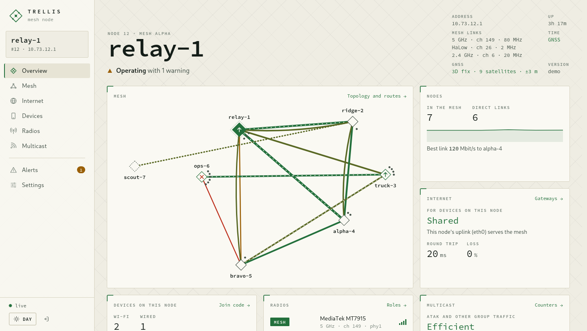
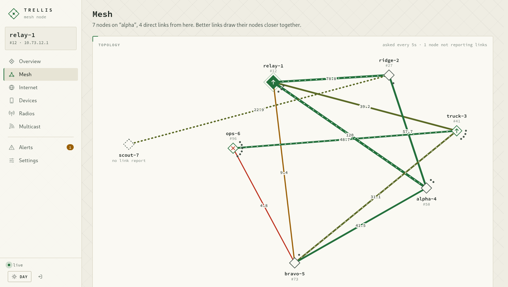
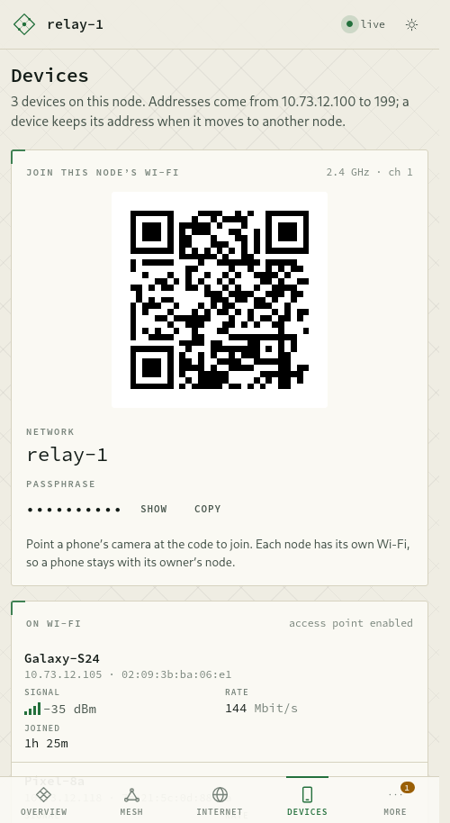

# Meridian Trellis

**An open-source tactical mesh radio system.** Each body-worn node gives
its user and team a self-forming, encrypted IP network, with ATAK support,
shared internet and a web UI that runs on a phone.



## What it does

- **Forms by itself.** Power nodes on and they find each other, encrypt
  every link, and route across as many hops as it takes. No base station,
  no planning, no single point of failure.
- **Uses every radio a node has.** 2.4 GHz, 5 GHz, 6 GHz and Wi-Fi HaLow
  links run at the same time; traffic takes the fastest path to each node,
  and nodes with different radios still mesh with each other.
- **One network for everyone.** Phones and laptops join their own node's
  Wi-Fi (or plug in) and reach every other device on the mesh by address or
  by name. A device keeps its address when it moves to another node.
- **Built for ATAK.** Multicast situational awareness works across the mesh
  out of the box, and goes only to the nodes that have listeners, so it
  keeps airtime free as the team grows.
- **Shares the internet.** Any node with an uplink (a wired line, an LTE or
  satellite router) shares it with the whole mesh, automatically. When it fails, traffic
  moves to the next-best uplink within seconds.
- **Run from a browser.** Set a node up by scanning a QR code with a
  phone, then watch the mesh live, see link speeds and routes, share the
  Wi-Fi code and change settings. Every change says what it will interrupt
  before it is applied.
- **Your spectrum, your call.** Country rules by default, or unrestricted
  operation for operators who hold their own frequency authorization.

| | |
|---|---|
|  |  |

## How it works

Nodes link with 802.11s and SAE, and route with batman-adv, so the whole
mesh is one flat IPv4 network: multicast, name lookup and device-to-device
traffic work across it with no gateway in the way. Every node answers as
the same gateway address for its own devices and forwards internet traffic
to whichever node has the best healthy uplink. A single Go daemon owns the
node's whole network state and keeps it in line with one declarative
configuration. More in [docs/architecture.md](docs/architecture.md).

Trellis targets meshes of 1 to 50 nodes on Debian-family Linux and runs on
common single-board computers with standard Wi-Fi adapters
([docs/hardware.md](docs/hardware.md)).

## Get started

- [Getting started](docs/guide.md): install Trellis on your devices from
  your computer, in six steps, and join the mesh with a phone.
- [Reference](docs/reference.md): every option, single-device installs,
  upgrades, radios, the web UI.
- [Supported hardware](docs/hardware.md): boards, radios, and how to test
  an adapter.
- [ATAK](docs/atak.md): settings for phones on the mesh.

For developers:

```sh
make            # bin/trellis (meshd, meshctl and webd in one binary)
make test       # unit tests
make ui-dev     # the web UI on http://127.0.0.1:8480 against demo data
make lab        # a 3-node mesh in network namespaces (needs batman-adv loaded)
make cross      # dist/ binaries for arm64, armv7 and amd64
make deb        # dist/deb/ packages for Debian, Ubuntu and Raspberry Pi OS
```

## Documentation

| Doc | What's in it |
|---|---|
| [docs/guide.md](docs/guide.md) | Getting started: the first-time setup, step by step |
| [docs/reference.md](docs/reference.md) | Installing, upgrading and running nodes, in detail |
| [docs/hardware.md](docs/hardware.md) | What a node needs; supported radios |
| [docs/architecture.md](docs/architecture.md) | Requirements, design, and the reasoning behind each decision |
| [docs/api.md](docs/api.md) | The HTTP/JSON API behind the web UI and `meshctl` |
| [docs/security.md](docs/security.md) | What Trellis protects, from whom, and what it does not protect yet |
| [docs/atak.md](docs/atak.md) | ATAK on the mesh |
| [docs/roadmap.md](docs/roadmap.md) | What's done and what's next |
| [CHANGELOG.md](CHANGELOG.md) | What changed in each release |
| [docs/dev/](docs/dev/layout.md) | Code layout, building, testing |

## Status

Working on real hardware and in a 50-node lab: the mesh, the client
network, gateways and failover, multicast, the web UI, multiple links per
node, both regulatory modes, packages with upgrades that go back by
themselves when a node is not healthy afterwards, and deploying to a set
of devices from one machine. Wi-Fi HaLow and field testing are in
progress, with upgrading a whole mesh from one node; images come next.
The current release is **0.2.0, an alpha**
([changes](CHANGELOG.md)). See the
[roadmap](docs/roadmap.md).

## Licence

Copyright (C) 2026 Eunoia IT Solutions LLC.

Trellis is free software under the [GNU GPL v3.0 only](LICENSE). A commercial
licence is also available for products that can't meet the GPL's terms; see
[LICENSING.md](LICENSING.md). "Meridian" and "Trellis" are trademarks and
aren't covered by either licence.

Outside code contributions aren't being accepted yet; bug reports and
hardware results are welcome. See [CONTRIBUTING.md](CONTRIBUTING.md).
